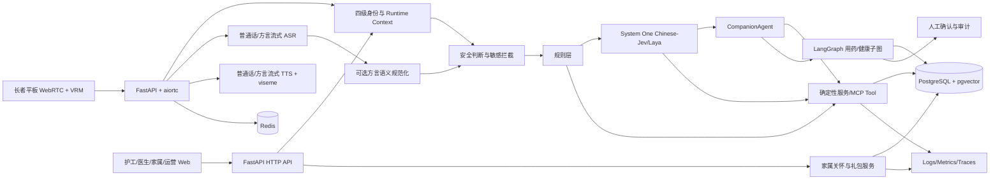

# 康伴 3D 数字人康养陪伴系统 TDD

> 文档版本：v0.3  
> 文档状态：技术设计草案，新增方言语音与家属关怀礼包；Day2 新增健康档案分级授权、家属健康 AI 解读与三主题前端，待 POC 与小组评审后固化  
> 需求依据：`PRD_康伴3D数字人.md`、`ADR_康伴3D数字人.md`、项目大纲 v1.3、Day1 骨架设计  
> 本文回答：系统如何实现、模块如何协作、数据如何保存、接口如何约定、如何测试与部署

---

## 1. 设计范围与约束

本设计覆盖完整 MVP，并标明 Day1 与后续阶段的边界。

Day1 已确定 FastAPI、PostgreSQL + pgvector、SQLAlchemy 2.x、Alembic、Redis、APScheduler、Settings、结构化日志和测试骨架；本文不将这些后续能力误写为 Day1 已完成。

强制约束：

- 不做医疗诊断，不替代 SOS。
- `elder_id` 由可信运行时身份上下文注入，不信任客户端、Prompt 或模型生成的身份。
- 敏感意图安全判断优先于普通路由；高危副作用必须 HITL。
- 单次对话 Tool 调用不超过 8 次，同一 Tool 一分钟内重复 3 次触发熔断。
- 原始音频仅作必要临时保存并最长 72 小时删除，日志和评测数据脱敏。
- 方言语音只通过官方 ASR/TTS API 和可选语义规范化接入，不自动操作网页版，不让外部对话模型接管项目回答或工具调用。
- 家属签到按社区日期累计且每位长者每日最多一条有效记录；礼包发放与核销必须幂等，不得扩大个人数据权限或接入支付采购。
- 健康档案按 basic/confidential 分级；健康 AI 解读仅 family/admin 且持 basic 查看授权可发起，出域白名单只含 basic 级去标识条目，confidential 级永不出库，每小时 1 次频控，失败不留档，输出固定附免责声明。
- 外部 HIS、微信使用 mock，媒体只使用授权、教学或公有领域资源。

## 2. 总体技术架构



架构采用单仓库、模块化单体后端和独立前端/MCP 服务。MVP 不拆微服务；System One、ASR/TTS、声纹等可通过适配器独立部署，但不改变业务边界。

## 3. 技术选型

| 层次 | 选型 | 用途与设计说明 |
| --- | --- | --- |
| 语言 | Python、异步编程 | 后端、实时流、Agent 与任务调度；版本在 `pyproject.toml` 统一锁定 |
| HTTP | FastAPI、Uvicorn、Pydantic、Pydantic Settings | API、结构化校验、配置与生命周期管理 |
| 实时语音 | WebRTC、aiortc | 全双工音频、反向提醒和信令；HTTP 文字聊天作为降级 |
| 方言语音 | 官方 ASR/TTS API + 可选规范化适配器 | 先验证一种方言；保留原始转写和置信度，关键语义低置信先复述，具体供应商由 POC 决定 |
| 主数据库 | PostgreSQL | 业务事务、授权关系、审计和 Checkpoint |
| 向量 | pgvector | 长期记忆与声纹向量；所有记忆查询强制身份和可见性过滤 |
| ORM/迁移 | SQLAlchemy 2.x、Alembic | 异步 ORM、事务和版本化迁移；迁移文件必须人审 |
| 缓存 | Redis | 短期对话状态、限流、重复调用检测；不是长期记忆的唯一存储 |
| 调度 | APScheduler | 用药、健康采集、音频清理和记忆维护任务 |
| System One | Chinese-Jev 或 Laya 本地开源权重 | 意图、敏感、置信度、隐私与域外判断；最终选型由 POC 决定 |
| System 2 | DeepSeek 或 Qwen 兼容 API | 开放域对话、结构化输出和记忆处理；通过统一 LLM 适配器接入。Day2 健康 AI 解读已经 OpenAI 兼容接口（`LLM_BASE_URL`/`LLM_API_KEY`/`LLM_MODEL`）先行接入并实测 DashScope 兼容模式连通，最终供应商由 POC-08 复核 |
| Agent | 受约束 CompanionAgent、Tool Calling | 只处理复杂、多工具请求；不接收模型自报的 `elder_id` |
| 状态工作流 | LangGraph + PostgreSQL Checkpointer | 用药与健康子图、Interrupt/HITL、断点恢复 |
| 家属关怀 | 确定性 FastAPI 服务 + PostgreSQL 事务 | 累计签到、关怀行动、规则版本、唯一约束、幂等发奖与线下核销，不引入自由 Agent |
| 工具协议 | MCP | 天气、HIS、微信等外部工具；统一 schema、超时、权限与审计 |
| 声纹 | 3D-Speaker CAM++ 或等价服务 | 双人间识别与单人间辅助校验；失败走主动确认 |
| 3D 前端 | VRM、`@pixiv/three-vrm` | 现成模型、眨眼、相机和 viseme；不自研图形学 |
| 后台前端 | 简单 HTML+JS/服务端渲染，Chart.js | 护工、医生、家属和运营页面；家属 H5 不引入重型框架 |
| 鉴权 | JWT、设备 Token、密码哈希 | 人账号与设备账号分离；只保存 Token 哈希或可吊销元数据 |
| 测试 | pytest、pytest-asyncio、httpx、pytest-cov、Ruff | 单元、集成、安全、迁移与覆盖率检查 |
| 部署 | Docker Compose、Nginx/HTTPS | 单社区教学部署、一键启动和回滚 |
| 观测 | JSON Logs、Prometheus Metrics、OpenTelemetry Traces、Langfuse | 请求、对话、模型、Tool、成本和评测观测 |

依赖版本必须在安装验证后锁定。POC 未通过的模型或 SDK 不得直接合并到主链路。

## 4. 模块职责

| 模块 | 职责 | 禁止事项 |
| --- | --- | --- |
| `app/api` | HTTP 输入输出、参数校验、鉴权依赖、统一错误 | 不写复杂业务编排 |
| `app/auth` | 人 JWT、设备 Token、角色和范围校验 | 不信任前端声明的角色或身份 |
| `app/realtime` | WebRTC 信令、媒体轨和实时会话 | 不直接决定医疗或工单副作用 |
| `app/router` | 规则层和级联路由 | 不堆积难以维护的关键词规则 |
| `app/system_one` | 快决策结构化输出、超时和降级 | 不生成自由文本，不执行高危副作用 |
| `app/agents` | CompanionAgent ReAct、预算与上下文 | 不绕过身份、权限和 HITL |
| `app/workflows` | 用药与健康有状态子图 | 不在 Prompt 中实现阈值和副作用规则 |
| `app/tools` | Tool 权限、MCP 客户端、重试和审计 | 不接收模型传入的可信 `elder_id` |
| `app/services` | 身份、记忆、用药、健康、媒体、工单、日报、签到与礼包等领域逻辑 | 不直接处理 HTTP 或 SDP，不用 Prompt 代替签到和发奖事务 |
| `app/integrations` | LLM、普通话/方言 ASR/TTS、可选规范化、声纹适配器 | 不泄露密钥，不让厂商 SDK 渗入领域层，不改写关键语义后直接执行 |
| `app/models` / `alembic` | ORM、约束和迁移 | 不盲跑自动迁移，不在初始迁移中随意追加未评审字段 |
| `app/observability` | 指标、Trace、Langfuse 和脱敏 | 不记录原始音频、完整病历或敏感正文 |

## 5. 核心运行设计

### 5.1 Runtime Context

每次请求建立不可由模型修改的上下文：

```json
{
  "elder_id": "uuid-or-null",
  "room_id": "uuid",
  "device_id": "uuid",
  "account_id": "uuid-or-null",
  "role": "elder|nurse|doctor|family|admin|anonymous",
  "identity_source": "device_room|voiceprint|explicit_confirmation|staff_token|anonymous",
  "identity_confidence": 0.0,
  "thread_id": "uuid-or-null",
  "trace_id": "uuid",
  "persona_config": {},
  "time": "ISO-8601"
}
```

匿名上下文的 `elder_id` 必须为 `null`，禁止访问个人记忆、健康、用药和家属数据。

### 5.2 三级路由与安全短路

处理顺序：

1. 建立身份和 Runtime Context。
2. 安全模块检查敏感意图；命中则进入人工确认队列，不进入开放域 Agent。
3. 规则层处理固定、无歧义指令。
4. System One 输出结构化判断。
5. 高置信单步意图进入确定性服务或 Tool。
6. 低置信或域外请求先澄清；复杂、多工具请求进入 CompanionAgent。
7. System One 不可用时记录降级事件；保留确定性安全规则，无法确定敏感性的输入采取保守策略。

System One 输出契约：

```json
{
  "intent": "chat|medication|opera|movie|weather|health|other",
  "is_sensitive": false,
  "sensitive_types": [],
  "confidence": 0.0,
  "needs_clarification": false,
  "privacy_restricted": false,
  "is_out_of_domain": false,
  "model_version": "pending"
}
```

置信度阈值默认 0.85，只有评测验证后才能调整。`decision_logs` 保存脱敏输入、输出、模型版本、路由层级和耗时。

### 5.3 CompanionAgent 约束

- System Prompt 只包含人设、称呼、时间和必要上下文，不包含密钥。
- 最近 5 轮原文 + 更早摘要 + Redis 结构化状态组成短期上下文。
- 长期记忆按 `elder_id + visibility + status` 过滤后再进行二次相关性判断。
- Tool 参数 schema 不包含可信任的 `elder_id`；由服务端执行上下文注入。
- 最多 8 次 Tool 调用；重复检测、超时、指数退避和降级话术统一封装。
- 用药与健康长流程只调用对应 LangGraph 子图，不另写一套平行逻辑。

### 5.4 用药工作流

状态至少包含：`plan_id / event_id / elder_id / attempt_count / status / scheduled_at / confirmed_at / last_response / workorder_id`。

流程：`calling → waiting_confirm → confirmed | retry → escalated`。

- 确认后写入用药事件。
- 否认或无应答，5 分钟后重试，最多三次。
- 三次失败创建漏服工单。
- 每次状态迁移写 Checkpoint；重启后从最近状态恢复。
- 主动外呼与对话内“我吃过药了”复用同一子图。

### 5.5 健康工作流

输入使用 Pydantic `HealthRecord` 校验：收缩压、舒张压、睡眠分钟数、情绪、主诉、来源和采集时间。

分级规则在确定性代码中实现：

- 绿色：正常入库，不建工单。
- 黄色：如收缩压 160–179，创建陪护复核事项，HITL 后归档或升级。
- 红色：如收缩压 ≥180，或胸痛、呼吸困难等严重主诉，进入紧急人工确认流程。

阈值、分支、通知对象和副作用全部进入 graph state 与审计日志。HITL 使用 Interrupt 暂停，确认接口恢复；确认前不得调用 HIS、微信或紧急通知 mock。

### 5.6 记忆设计

链路：萃取 → 写入 → 按身份召回 → 二次相关性过滤 → 冲突处理 → 衰减/归并。

- 写入包含 `category / visibility / status / embedding_model / created_at`。
- 查询强制 `elder_id = runtime.elder_id`，并追加可见性和状态条件。
- 相似度大于 0.9 且语义矛盾时，旧记录标记 `superseded`，新记录保留时间戳。
- 私有偏好与医护共享信息分开授权。
- 原始对话不默认永久保存，长期记忆只保存必要摘要。

### 5.7 方言语音链路

```text
方言音频  →  官方流式 ASR  →  原始转写与置信度  →  可选语义规范化
→  项目安全判断 / 规则层 / System One / CompanionAgent / 工作流
→  受控回答  →  方言或普通话流式 TTS  →  播放与口型
```

ASR 与规范化结果使用统一 Schema，至少包含：

```json
{
  "raw_transcript": "原始转写",
  "normalized_text": "规范化文本或 null",
  "detected_dialect": "pending",
  "asr_confidence": 0.0,
  "normalization_confidence": null,
  "needs_clarification": true
}
```

- 首版只选择一种目标方言，官方 API、模型、流式协议和阈值通过 POC 决定；不自动操作网页版对话产品。
- 普通请求只有在评测证明有必要时才增加规范化，不为每句话固定追加一次大模型调用；路由和 Agent 使用经校验的文本，原始转写仅按脱敏与保留策略留痕。
- 药名、剂量、数值、时间和否定词属于关键语义，规范化前后必须一致；任一相关置信度不足或语义变化无法解释时设置 `needs_clarification=true`，用受控话术复述确认。
- 用药确认、健康采集和敏感求助在低置信时不得直接写入已确认状态、触发分级或执行副作用；方言适配不得绕过身份、安全路由和 HITL。
- 方言 TTS 不可用时降级为普通话 TTS，ASR 或规范化不可用时降级为普通话识别、文字输入或人工流程；分别记录 ASR、规范化、路由和 TTS 延迟及 bad case。

### 5.8 家属累计签到与礼包

流程：关联校验 → 服务端确定社区日期 → 幂等签到/记录关怀行动 → 统计有效累计天数 → 达到规则版本阈值 → 事务内解锁礼包 → 授权线下核销。

- 有效奖励签到以“每位长者 + 每个社区本地日期”为粒度，同日多个家属或重复请求不增加累计天数；累计签到不因漏签清零。
- `elder_id` 即使位于路径中，也必须与当前家属账号的有效关联关系匹配；客户端提交的账号、日期、累计天数和礼包状态均不可信。
- 语音、照片、问候、通话和线下探望等关怀行动单独记录，是否计入奖励由经评审的规则明确，不能通过虚构行动批量刷取权益。
- 签到、计数、发奖使用数据库事务和唯一约束；同一长者的同一规则版本最多产生一个有效 `reward_grant`，重复请求返回既有结果。
- 礼包状态至少覆盖 `unlocked / redeemed / expired / cancelled`；核销仅允许授权运营角色，使用 `Idempotency-Key`、状态校验和审计，重复核销不重复执行。
- 奖励只代表教学模拟权益，不改变家属对日报、健康、记忆或对话的访问范围；MVP 不接支付、采购或真实商品履约。

### 5.9 健康档案分级授权与 AI 解读（Day2 已实装）

#### 5.9.1 数据分级口径

- `vital / body_part / medication / chronic` 四类档案条目 `data_level=basic`；`major`（重大疾病）类服务端强制 `data_level=confidential`，不信任任何客户端传入的分级。
- 档案为纵向记录式（逐条追加），修改历史由审计流水补足；写入角色 `recorded_role` 由服务端按当前身份注入（nurse/doctor/admin）。

#### 5.9.2 三层访问控制

判定顺序固定，前一层不通过即终止：

1. **范围判定**：复用现有角色范围（护工按楼栋、医生/家属按关联关系）；范围外一律 404（隐藏存在性，与不存在长者不可区分），无权限角色 403。
2. **健康授权 ACL**（`health_grants`）：管理员逐人配置"账号 × 长者 × 查看/编辑 × basic/confidential"四个布尔位；编辑位必须包含对应查看位，否则 422；吊销为软吊销（`status=suspended`），可恢复。
3. **数据分级过滤**：无相应级别授权的记录在查询层直接过滤，不返回占位或空壳记录。护工在任何路径下都拿不到 confidential 级记录。

管理员角色恒有全量档案与审计权限，作为兜底。

#### 5.9.3 API 与行为语义

| 接口 | 角色 | 语义 |
| --- | --- | --- |
| `GET /api/v1/elders/{id}/health` | 范围内 + ACL | 按授权级别过滤后的档案条目 |
| `POST /api/v1/elders/{id}/health`、`PUT /api/v1/health/{record_id}` | 需编辑位 | 写入/更新并写审计流水（旧值→新值，只增不改） |
| `GET/POST /api/v1/elders/{id}/health/summaries` | 医生生成 / 范围内查看 | 版本自增的规则式聚合摘要 |
| `POST …/summaries/{sid}/ack` | 家属 | 已阅回执，重复回执幂等 |
| `POST …/health/ai-analysis` | family/admin + basic 查看位 | 见 5.9.4 |
| `GET …/health/ai-analyses` | family/admin + basic 查看位 | 历史分析记录回看 |
| `GET …/health/export` | 范围内 + ACL | 打印版 HTML 导出 |
| `GET /api/v1/nurse/tasks/pending-measures` | 护工 | 今日待录入体征清单（EXPECTED_DAILY_VITALS 当日未录） |
| `GET /api/v1/nurse/health-overview` | 护工 | 所辖楼栋预警长者集合（severity=warning 黄标） |
| `GET/POST/PUT/DELETE /api/v1/admin/health-grants…` | 管理员 | 授权矩阵 CRUD |
| `GET /api/v1/admin/health-audit` | 管理员 | 审计流水查询 |
| `GET /api/v1/config/flags` | 公开 | `ai_analysis_enabled` 开关（前端据此置灰 AI 按钮） |

#### 5.9.4 AI 解读链路

```text
家属/管理员发起 → 角色与 basic 查看位校验 → 每小时 1 次频控（429）
→ 出域白名单提取（仅 basic 级 item_key/value_text，去姓名/UUID/房间号）
→ 服务端固定提示词模板（prompt_version 留档，不信任前端传词）
→ OpenAI 兼容 LLM 调用（LLM_BASE_URL/LLM_API_KEY/LLM_MODEL 环境注入）
→ 成功：解读文本 + model_name + prompt_version + requested_by 写入 health_ai_analyses
→ 失败：502，不留档；未配置：503；超限：429
```

红线：confidential 级内容在服务端剔除、不参与出域；输出固定附免责声明（不构成诊断）；模型不可用时经 `/config/flags` 整体降级关闭，不换用不受控通道。

#### 5.9.5 前端承载

四页改造已落地：家属端健康档案弹窗（AI 按钮 + 摘要已阅 + 导出）；护工端今日待录入清单 + 预警黄标 + 基础档案；医生端全档编辑 + 生成摘要 + 导出；管理员端健康授权矩阵 + 审计流水页签。导出经 `KB.openAuthorized`（带 Bearer 取回 blob 再开新标签），避免新标签直接打开带鉴权 URL 报 401。

## 6. 数据模型设计

### 6.1 通用规范

- 主键使用 UUID；时间使用 `TIMESTAMPTZ` 并统一 UTC，展示和调度使用配置时区。
- 状态字段采用 `VARCHAR + CHECK`，迁移变更需评审。
- 外键、唯一约束、索引和删除策略必须在 ER 文档与 Alembic 中一致。
- 个人数据默认 `RESTRICT` 删除；退房通过显式匿名化/删除流程处理并写审计。
- Token 和密钥不明文落库；密码只存强哈希。
- 向量模型确定后再固定维度和 ANN 索引，不在 Day1 猜测维度。

### 6.2 Day1 十一张基础表

| 表 | 核心设计与约束 |
| --- | --- |
| `rooms` | `room_id`、楼栋、楼层、房号、`bed_count`、状态；楼栋/楼层/房号唯一，床位数限 1–2 |
| `devices` | `device_id`、`device_code`、`room_id`、可空 `bed_no`、类型、状态、`last_seen_at`；设备编码唯一 |
| `personas` | `persona_id`、唯一编码、名称、形象、性格、问候语、音色、启用状态 |
| `elders` | `elder_id`、姓名、出生日期、性别、`room_id + bed_no`、`persona_id`、状态；床位部分唯一约束 |
| `memory_chunks` | `chunk_id`、`elder_id`、内容、向量、模型、分类、`visibility`、状态、过期时间；支持 `superseded` |
| `medication_plans` | `plan_id`、`elder_id`、药品、剂量、JSONB 日程、说明、起止日期、状态 |
| `media_library` | `media_id`、类型、标题、剧种/题材、年代、艺术家、资源地址、时长、版权和状态；仅合规资源可激活 |
| `health_records` | `record_id`、`elder_id`、采集时间、血压、睡眠、情绪、主诉、来源；必要范围 CHECK |
| `voiceprints` | `voiceprint_id`、`elder_id`、向量、模型、临时样本引用、状态、过期时间；向量加密方案待 POC |
| `workorders` | `workorder_id`、`elder_id`、类型、状态、优先级、处理人外部引用、标题、描述、解决时间 |
| `conversations` | `thread_id`、可空 `elder_id/device_id`、`session_seq`、身份来源、状态、起止时间；`(elder_id, session_seq)` 唯一 |

### 6.3 后续业务表落地进展（迁移 0003–0005）与仍待新增表

Day1 的 11 表不是完整业务数据库。后续业务表通过新迁移加入，不回改已执行迁移。截至 Day2，以下迁移已人审并升级开发库：

- `0003_accounts_device_tokens`：`accounts`（账号、角色、用户名、密码哈希、状态）、`device_tokens`（设备 Token 哈希、签发/过期/吊销，不存明文）。
- `0004_authorization_links`：`building_assignments`（护工-楼栋）、`doctor_elder_assignments`（医生-长者）、`family_elder_links`（家属-长者，有效期内关联）。
- `0005_health_profile`：健康档案五表，见 §5.9——`elder_health_records`（五类纵向档案 + basic/confidential 分级 + 写入角色）、`health_grants`（账号 × 长者四布尔授权位，唯一约束 `(account_id, elder_id)`，软吊销）、`health_audit_logs`（create/update/delete 前后快照流水）、`health_ai_analyses`（出域快照留档，仅 basic 级）、`health_summaries`（医生摘要版本留档 + 家属已阅回执幂等）。

仍待评审新增的表：

| 表/模型 | 必要性 | 关键内容 |
| --- | --- | --- |
| `staff_tokens` | 护工临时身份确认 | 护工、设备、Token 哈希、过期时间、使用状态 |
| `medication_events` | 记录提醒、确认、重试和漏服 | `plan_id`、`elder_id`、计划时间、状态、次数、确认时间、关联会话和工单 |
| `decision_logs` | 路由评测与误判分析 | 脱敏输入、意图、置信度、敏感标记、路由层级、耗时、模型版本 |
| `media_history` | 播放记录和偏好学习 | 长者、媒体、起止时间、完成率、播放控制事件 |
| `health_events` | 健康分级与 HITL 状态 | 健康记录、严重度、规则依据、状态、确认人、确认时间、关联工单 |
| `family_reports` | 日报生成、授权和推送状态 | 长者、日期、脱敏摘要、语音地址、接收家属、发送/打开状态 |
| `family_checkins` | 累计签到与防重复 | 签到 ID、长者、发起家属账号、社区本地日期、状态、创建时间；有效签到对 `(elder_id, checkin_date)` 建部分唯一索引 |
| `family_care_activities` | 真实关怀行动记录 | 活动 ID、长者、家属账号、类型、授权内容或媒体引用、发生时间、来源、状态；与奖励签到分责 |
| `reward_rules` | 可版本化的礼包规则 | 规则 ID、累计天数、奖励内容、版本、有效期、启停时间、状态；N 和内容由运营评审配置 |
| `reward_grants` | 礼包解锁、领取和核销 | 发放 ID、长者、规则及版本、来源签到计数、状态、解锁/过期/核销时间、核销人；对 `(elder_id, reward_rule_id, rule_version)` 建有效发放唯一约束 |
| `audit_logs` | 高危操作和权限审计 | 操作者、动作、对象、结果、原因、trace_id、时间；敏感内容脱敏 |
| `metrics` | 延迟与成本基线 | 请求/会话、阶段耗时、路由层级、Token、错误和成本指标 |

新增表必须与 PRD 的权限、用药、健康、日报、家属关怀和评测需求一一对应，避免只建“能登录”“能提醒”或“能签到”的空壳模型。方言 Schema 不要求新增 Day1 表，四张关怀表也不得回改 Day1 初始迁移。

### 6.4 数据保留与删除

- 原始音频：临时存储，最长 72 小时，由调度任务清理并记录结果。
- 声纹：embedding 加密；样本 URI 不视为永久资源；支持吊销和退房删除。
- 长期记忆：支持替代、抑制、删除和过期，不保存无必要原始对话。
- 日志：只保存脱敏文本和必要指标；不记录密码、Token、Key、完整病历。
- 方言数据：原始音频沿用 72 小时上限；原始转写、规范化文本和 bad case 仅按评测所需最小化脱敏保存，不因增加方言能力扩大采集范围。
- 日报：仅保存授权摘要和必要投递状态，不作为完整病历。
- 家属关怀：只保存授权关怀行动和必要媒体引用；签到与礼包记录用于权益和审计，不作为获取更多个人数据的依据。

## 7. API 契约设计

### 7.1 通用约定

- 业务 API 前缀：`/api/v1`；Day1 存活检查为 `GET /health`。
- 人账号使用 `Authorization: Bearer <user-jwt>`；设备使用独立设备 Token。
- 可传入合法 `X-Trace-ID`，否则服务端生成；所有错误响应包含 `trace_id`。
- 高危确认、副作用、家属签到和礼包核销接口支持 `Idempotency-Key`，防止重复通知、建单、累计或核销。
- 请求体验证失败返回 422；未认证 401；越权 403；资源不存在或按策略隐藏为 404；状态冲突 409；限流 429。
- `elder_id` 即使出现在路径或查询参数中，也必须经过服务端权限校验；Tool 执行身份只取 Runtime Context。

统一错误结构：

```json
{
  "error": {
    "code": "FORBIDDEN",
    "message": "无权访问该资源",
    "trace_id": "uuid",
    "details": null
  }
}
```

### 7.2 核心接口清单

| 方法 | 路径 | 调用方/权限 | 请求与结果概要 |
| --- | --- | --- | --- |
| GET | `/health` | 公开 | 返回应用存活状态，不访问数据库 |
| GET | `/api/v1/config/flags` | 公开 | 返回功能开关（`ai_analysis_enabled`），不含个人数据 |
| POST | `/api/v1/elders/{id}/health`、`GET/PUT` 同族 | 范围内角色 + 健康授权 ACL | 健康档案读写；basic/confidential 分级过滤；写操作留审计流水（§5.9） |
| POST | `/api/v1/elders/{id}/health/ai-analysis` | family/admin + basic 查看位 | basic 级脱敏出域 LLM 解读；503 未配置 / 429 每小时 1 次 / 502 失败不留档（§5.9.4） |
| POST | `/api/v1/auth/login` | 人账号 | 账号凭证 → 用户 JWT 与角色信息；错误凭证 401 |
| POST | `/api/v1/auth/device/register` | 设备注册凭证 | 设备编码和注册凭证 → 设备 Token、设备 ID、过期时间 |
| GET | `/api/v1/auth/me` | 人/设备 | 返回当前账号或设备身份，不混用两种 Token |
| POST | `/api/v1/elders` | 管理员 | 创建长者档案；返回创建结果；非管理员 403 |
| GET | `/api/v1/elders/{elder_id}` | 授权护工/医生/管理员 | 返回授权范围内档案，跨范围 403/404 |
| PUT | `/api/v1/devices/{device_id}/binding` | 管理员 | 绑定房间和可选床位；写审计 |
| POST | `/api/v1/rtc/offer` | 设备 | SDP offer → SDP answer；设备身份进入实时会话上下文 |
| POST | `/api/v1/conversations` | 设备/授权用户 | 创建或恢复会话；返回 `thread_id`，身份由服务端确定 |
| POST | `/api/v1/conversations/{thread_id}/messages` | 会话所有者 | 文字降级输入 → 路由结果和回复；伪造他人会话 403 |
| POST | `/api/v1/medication-plans` | 护工/医生 | 创建计划；需要相应权限和审计 |
| POST | `/api/v1/medication-events/{event_id}/confirm` | 当前长者设备/授权人员 | 确认用药事件；幂等更新，不能通过请求体替换长者身份 |
| POST | `/api/v1/health-records` | 当前长者设备/授权人员 | 写入结构化健康记录并触发健康决策图 |
| GET | `/api/v1/health-records?elder_id=...` | 本人/授权护工/医生 | 返回时间范围健康记录；家属不能调用完整记录接口 |
| POST | `/api/v1/health-events/{event_id}/confirm` | 授权护工/医生 | 提交 HITL 决定并恢复图；使用 Idempotency-Key |
| GET | `/api/v1/media` | 设备/授权用户 | 按类型、剧种、年代、题材检索合规媒体 |
| POST | `/api/v1/media-history` | 当前长者设备 | 写入播放开始、结束和完成率 |
| GET | `/api/v1/workorders` | 护工/医生 | 仅返回负责范围工单和待确认事项 |
| POST | `/api/v1/workorders/{order_id}/actions` | 授权护工/医生 | 确认、处理、升级或关闭；状态冲突 409，写审计 |
| GET | `/api/v1/family/reports` | 家属 | 仅返回与当前账号关联长者的日报摘要 |
| POST | `/api/v1/family/elders/{elder_id}/checkins` | 关联家属 | 服务端确定社区日期并幂等签到；返回累计进度；跨家属、伪造日期或重复累计被拒绝/去重 |
| POST | `/api/v1/family/elders/{elder_id}/care-activities` | 关联家属 | 记录语音、照片、问候、通话或线下探望等授权行动；内容按类型校验 |
| GET | `/api/v1/family/elders/{elder_id}/reward-progress` | 关联家属 | 返回累计有效签到、当前规则版本和本人关联长者的礼包状态，不返回额外个人数据 |
| POST | `/api/v1/admin/reward-rules` | 管理员/授权运营 | 创建有版本的累计天数与礼包规则；变更写审计 |
| POST | `/api/v1/admin/reward-grants/{grant_id}/redeem` | 管理员/授权运营 | 线下核销；使用 `Idempotency-Key`，状态冲突 409，重复请求不重复执行 |
| POST | `/api/v1/admin/personas` | 管理员 | 创建/配置人设，其他角色 403 |

### 7.3 代表接口示例

`GET /health` 成功响应：

```json
{
  "status": "ok",
  "app_env": "local",
  "trace_id": "uuid"
}
```

创建健康记录请求：

```json
{
  "recorded_at": "ISO-8601",
  "bp_systolic": 128,
  "bp_diastolic": 76,
  "sleep_minutes": 420,
  "mood": "calm",
  "chief_complaint": null,
  "source": "voice"
}
```

创建响应只返回记录 ID、接收状态、当前处理状态和 `trace_id`，不返回诊断结论。若触发健康事件，客户端可查询授权范围内的事件状态，但最终副作用仍由 HITL 决定。

## 8. 安全与权限设计

1. 四级身份：设备绑定 → 房间候选 → 声纹 → 主动确认/护工临时授权。
2. 会话隔离：`thread_id` 所有权与当前身份绑定，伪造他人 ID 返回 403。
3. 记忆隔离：所有 pgvector 查询强制 `elder_id`、可见性和状态过滤。
4. Tool 授权：从 Runtime Context 注入身份，忽略模型自报身份。
5. 人/设备凭证分离：不同签名或验证策略、过期与吊销机制；设备 Token 不可调用人类后台接口。
6. 高危 HITL：通知、HIS、紧急工单等副作用必须等待人工确认并幂等执行。
7. 注入防护：Prompt 注入测试、Tool 参数 schema、输出校验和最小权限。
8. 日志安全：敏感字段脱敏，禁止密钥、Token、原始音频和完整病历进入日志。
9. 方言输入：原始转写与规范化文本均视为不可信输入；关键语义校验失败时只澄清，不执行；外部语音或规范化服务不能获得项目工具权限。
10. 家属关怀：校验账号与长者关联、服务端日期和运营核销权限；数据库唯一约束兜底并发签到/发奖，奖励领取前后复测数据权限不变。
11. 健康档案三层 ACL：范围判定（范围外 404 隐藏存在性）→ `health_grants` 授权（编辑位必须含查看位）→ basic/confidential 分级过滤；护工任何路径不可见 confidential；AI 解读仅 basic 级去标识出域、频控与免责固定（§5.9）。

## 9. 可观测与评测设计

- Logs：JSON 格式，包含 `trace_id / thread_id / identity_source / route / status / latency`，敏感字段脱敏。
- Metrics：请求量、错误率、ASR/TTS 首包、LLM 首 Token、端到端 P50/P95、路由占比、System One 闭环率、Tool 次数、Token 与成本；方言另记规范化延迟、低置信复述和降级，家属关怀另记有效签到、关怀行动、礼包解锁/核销和幂等命中。
- Traces：设备/请求 → ASR → 可选方言规范化 → 安全与路由 → Agent/Tool/子图 → TTS → 前端播放；家属请求 → 关联校验 → 签到/关怀 → 发奖/核销 → 审计。
- `decision_logs`：用于误判分析，不保存无必要敏感正文。
- 固定 20 个长者场景做综合回归；System One 另用 50 条标注样例建立分类基线；方言 POC 使用 30–50 条覆盖关键语义的教学语料。
- bad case 按 ASR、方言规范化、System One、召回、LLM、Tool、编排分层归因并回流 fixtures；关怀 bad case 按关联、日期、计数、发奖、核销分层归因。
- `eval_gate.py` 检查关键指标，未达到发布阈值时阻止交付。

## 10. 测试设计

| 测试层 | 内容 |
| --- | --- |
| Day1 骨架 | `/health`、Settings、空后续密钥启动、trace_id、迁移升级和 11 表结构 |
| 单元测试 | 规则层、阈值、权限判断、Tool 参数、重试、状态机、记忆过滤 |
| 集成测试 | 登录、设备注册、长者 CRUD、PostgreSQL、Redis、WebRTC、MCP、Checkpoint |
| 安全测试 | 伪造 Token/thread_id/elder_id、跨楼栋、跨家属、Prompt 注入、日志脱敏 |
| 工作流测试 | 用药三次重试、重启恢复、绿/黄/红分支、HITL 前无副作用、幂等确认 |
| 方言语音测试 | Schema 契约、原始/规范化文本一致性、药名/剂量/数值/时间/否定词低置信复述、未确认不写状态、普通话/文字降级、TTS 故障提示 |
| 家属关怀测试 | 跨家属越权、同日重复、跨天累计、漏签不清零、并发签到/发奖、同一规则只发一次、重复核销、奖励前后数据权限一致 |
| 健康档案测试 | 三层 ACL（范围外 404、无 ACL 403、分级过滤）、编辑位含查看位校验、护工不可见 confidential、审计流水前后快照、AI 出域白名单与 503/429/502 语义、摘要 ack 幂等 |
| 性能测试 | 固定样本的 P50/P95、System One 延迟、方言各阶段延迟、并发会话和资源占用 |
| 前端测试 | 语音状态、口型、375px H5、大字号、高对比、服务失败不白屏 |
| 部署测试 | 新环境 Compose 启动、HTTPS、健康检查、回滚 |

所有测试必须有真实业务断言；写操作除 HTTP 200 外，还需回查数据库或状态。

## 11. 配置、部署与恢复

- `.env.example` 只含安全占位；Day1 基础配置必填，后续模型/语音/JWT 等字段在对应阶段启用前为 Optional；`ASR_DIALECT`、`TTS_DIALECT` 和方言规范化开关/阈值仅在 POC-10 启用时校验，不虚构厂商参数。
- 密钥只来自环境或密钥管理机制，不进入 Git、Prompt、镜像和日志。
- Compose 目标服务：PostgreSQL + pgvector、Redis、backend、frontend、System One、MCP servers、Langfuse。
- Nginx 提供 HTTPS 与反向代理；WebRTC 的 STUN/TURN 按实际网络拓扑配置。
- Alembic 迁移在发布前审查 upgrade/downgrade；数据库回滚与代码回滚分开验证。
- Checkpoint 用于会话与工作流恢复，不能替代数据库备份。

## 12. POC 到技术设计的门禁

| PRD POC | 技术验证产物 | 未通过时的处理 |
| --- | --- | --- |
| POC-01/02 | WebRTC 回声、ASR/TTS 适配器和延迟记录 | 保留文字降级，不进入端到端承诺 |
| POC-03 | Laya/Chinese-Jev spike、50 条样例、延迟与准确率报告 | 调整模型或路由，不虚构准确率 |
| POC-04 | 声纹阈值、误识/拒识与降级报告 | 双人间强制主动确认或通用模式 |
| POC-05 | 越权攻击测试和审计记录 | 阻止合并，不进入后续个人数据功能 |
| POC-06 | LangGraph 状态恢复和 HITL 副作用测试 | 禁用自动副作用，只保留人工流程 |
| POC-07 | 记忆隔离、冲突和噪声过滤测试 | 不启用个性化记忆 |
| POC-08 | 延迟、闭环率和成本基线 | 优化路由/流式链路，不宣称达标 |
| POC-09 | 一键部署与回滚记录 | 不发布 |
| POC-10 | 一种方言的 30–50 条教学语料、原始/规范化文本、关键语义复述、ASR/TTS 延迟、可理解度和降级报告 | 不启用方言关键业务自动确认；保留普通话/文字或人工流程，不虚构识别效果 |
| POC-11 | 关联越权、签到唯一、累计规则、并发事务、幂等发奖/核销和权限不变测试 | 不上线自动发奖；保留人工登记，不通过奖励开放个人数据 |

## 13. 待 POC 确认的技术事项

1. Python、依赖和模型的最终锁定版本。
2. DeepSeek/Qwen、Chinese-Jev/Laya 的最终选择及许可证核验。
3. Embedding 模型、维度、距离度量、索引和声纹加密方案。
4. ASR/TTS 厂商、流式协议、viseme 获取方式与超时阈值。
5. MCP 使用 stdio 还是 HTTP，以及对应配置和鉴权方式。
6. 账号与授权关联表的具体拆分、设备凭证存储方式——已由迁移 0003/0004 落地（`accounts`、`device_tokens`、`building_assignments`、`doctor_elder_assignments`、`family_elder_links`），不改变 ADR-005/013。
7. 家属日报推送和打开率的 mock 统计口径。
8. 端到端 1.5 秒目标在教学网络与所选服务上的可达性。
9. 方言官方 ASR/TTS 供应商、目标方言、规范化必要性、关键语义置信度阈值及普通话/文字降级策略。
10. 家属关怀行动类型与计奖口径、累计天数 N、礼包内容和有效期、规则版本升级后的进度处理及线下核销角色。

## 附：Day3 实装增补（2026-11-05）

> 本节为 Day3 实测后的补充记录，原 §5.7/§6/§7 内容不变。§13 第 3 项（声纹加密）、第 4 项（ASR/TTS 厂商与 viseme）已部分收敛，见下；方言（第 9 项）仍待 POC-10。

### A. 语音链路首版落地形态（对应 §5.7）

§5.7 设计的方言链路在 Day3 落地为「普通话首版」（方言规范化仍【后续】，由 POC-10 决定）：

- ASR：**FunASR 官方实时识别镜像**（本地 Docker，`compose.funasr.yaml`，WSS 2pass 流式）——经 `funasr_ws.py` 适配为 `ASRProvider`；镜像 offline 阶段结果不带 `is_final` 字段，以 `mode` 含 `offline` 判定终句；`results()` 设 10s 死线防零音频会话卡死。
- TTS：**Edge-TTS**（`edge_tts.py`）+ PyAV 解码为 16k PCM（免 ffmpeg 系统依赖），适配为 `TTSProvider`。
- 声纹：**sherpa-onnx CAMPPlus（192 维）+ TEN-VAD**（`sherpa_voiceprint.py`），存储无关；embedding 由服务层写入 `voiceprints`（pgvector）。
- 实时音频：**aiortc** WebRTC（`app/realtime/session.py`，浏览器麦克风 → 服务器 16k 重采样 → VoiceSession；TTS 音频帧回推）。
- 安全语义：声纹仅作辅助身份信号（阈值 0.55），通过后签发 300s 临时验证 Token（仅内存，重启即失效，不落库）；验证失败进入通用模式（不带个人记忆）；TTS 播放期静音麦克（半双工防回声转写）。

### B. §7.2 接口清单增补（Day3 已实装）

| 方法 | 路径 | 调用方/权限 | 请求与结果概要 |
| --- | --- | --- | --- |
| WS | `/api/v1/voice/ws` | 设备 Token 或管理员 JWT（连接后首条消息鉴权，二者互斥） | 实时语音会话：PCM/控制消息 ↔ verification/transcription/reply/tts/error 事件；声纹门控在前 |
| POST | `/api/v1/voice/enroll/device` | 设备 Token | 单人间设备为在住长者录声纹（5s 音频）；双人间 403（ADR-005） |
| POST | `/api/v1/voice/enroll/admin` | 管理员 JWT + 指定 elder_id | 双人间管理员通道录入（ADR-005 落地） |
| GET | `/api/v1/voice/voiceprints` | 管理员 | 查询声纹录入状态 |
| GET | `/api/v1/voice/biometric/rooms` | 公开（`BIOMETRIC_DEMO_ENABLED=1` 时） | 返回房间列表（房号/床数/在住长者/活跃设备码），供登录页生物识别选房 |
| POST | `/api/v1/voice/biometric/login` | 公开（同上开关；关闭时 403） | `fingerprint` 模式（教学演示，点击即签发该房间活跃设备的真实设备 JWT）/ `voiceprint` 模式（5s 音频真比对 CAMPPlus 声纹库，阈值 0.55，通过后同样签发设备 JWT 并附 matched_elder/score）；无活跃设备房间 409，参数缺失/不匹配 422 |

### C. 新增模块职责（对应 §4）

- `app/integrations/`：ASR/TTS/Voiceprint 三 Provider 抽象接口 + FunASR/Edge-TTS/sherpa 三实现（ADR-018，POC-01/02 选型结论）。
- `app/services/voice.py`：VoiceSession 状态机、声纹门控、临时 Token 存储、模板回复编排、`embedding_reloader` 快照现场重查。
- `app/realtime/session.py`：aiortc 会话管理（offer/answer、重采样、异常自愈）。

### D. 配置字段增补（对应 §11，全部 Optional 缺省可启动）

`FUNASR_URL`、`FUNASR_INSECURE`、`EDGE_TTS_VOICE`、`VOICEPRINT_THRESHOLD`（默认 0.55）、`VOICEPRINT_TOKEN_TTL`（默认 300s）、`SHERPA_MODEL_DIR`、`RTC_ICE_SERVERS`、`BIOMETRIC_DEMO_ENABLED`（默认 1；置 0 关闭生物识别演示入口，恢复严格鉴权）。

### E. 测试基线更新

Day3 语音四件套 28 例（配置缺省启动/声纹状态机与入库/rtc offer 权限/WS 协议序列）+ 生物识别 9 例（开关 403/房间列表/指纹签发/声纹比对/409/422 等），全量 **136 passed**（Day2 末 99 例零回归）。
