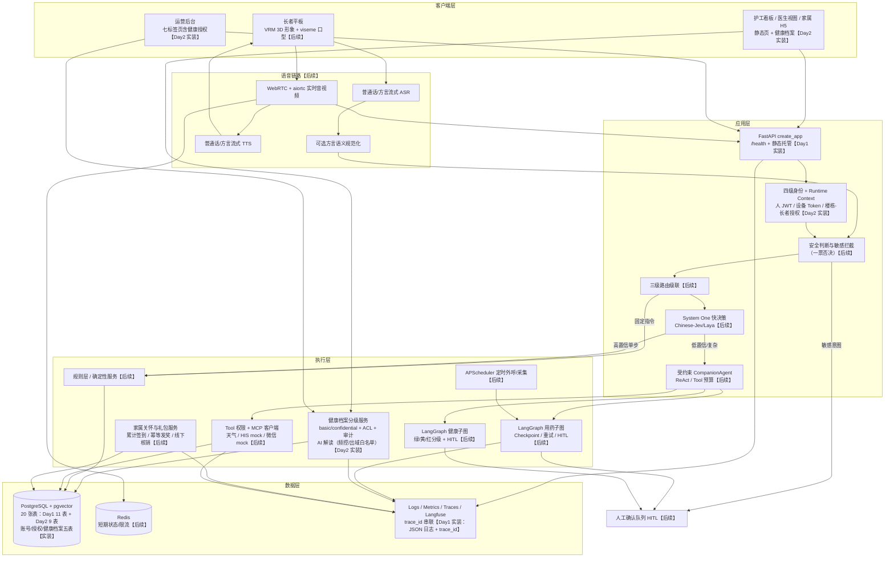

# 架构与 Agent 闭环图

> 标注说明：【Day1 实装】= 本阶段已交付；【Day2 实装】= Day2 已交付（账号授权、健康档案、四页前端、三主题）；【后续】= 后续阶段能力，暂不实现。

## 闭环说明

1. **请求进入**【Day1 实装基础链路】：Uvicorn → `create_app()` → TraceIdMiddleware（合法 `X-Trace-ID` 透传/非法重生成，contextvars 绑定，响应头回传）→ 异常边界 → API 路由 → StaticFiles 根路径托管前端。Day1 仅 `/health`；Day2 起承载全部业务 API。
2. **身份与安全**【Day2 实装账号授权部分】：人 JWT / 设备 Token 双凭证体系（迁移 0003/0004）、护工-楼栋 / 医生-长者 / 家属-长者授权关联、范围外 404 隐藏存在性；四级身份级联（设备绑定→房间候选→声纹→主动确认/护工授权）中的声纹与主动确认仍为【后续】。
3. **健康档案闭环**【Day2 实装】：范围判定 → health_grants ACL → basic/confidential 分级过滤三层访问控制；写操作留审计流水；护工待录入/预警、医生全档编辑+摘要+导出、家属查看+已阅+AI 解读（仅 basic 级脱敏出域、每小时 1 次频控、失败不留档，ADR-017）。
4. **三级路由**【后续】：规则层 → System One（结构化快决策）→ 唯一受约束主控 Agent；简单请求在规则层/System One 闭环。
5. **执行**【后续】：确定性服务 / MCP Tool / LangGraph 子图（用药、健康分级工作流）；高危副作用必须 HITL 确认后执行。
6. **数据**【实装 20 表】：PostgreSQL + pgvector 承载业务数据（Day1 11 表 + Day2 账号 2 表、授权关联 3 表、健康档案 5 表）、长期记忆、声纹与 Checkpoint；Redis 承载短期状态【后续】。
7. **观测闭环**【Day1 实装：结构化 JSON 日志 + trace_id】：每个请求完成日志含 trace_id、方法、路径、状态码、耗时；健康档案写操作另留 `health_audit_logs` 审计流水；Metrics/Traces/Langfuse 为后续扩展。

## Day1 实装清单

- FastAPI 应用工厂 + `/health`（不访问数据库）
- Pydantic Settings 统一配置（后续字段 Optional）
- 结构化 JSON 请求日志 + trace_id 中间件
- PostgreSQL 异步引擎/会话入口 + SQLAlchemy 2.x 11 表 ORM
- Alembic 两版初始迁移（0001 核心四表 / 0002 领域七表）

## Day2 实装清单

- 迁移 0003（accounts、device_tokens）/ 0004（护工-楼栋、医生-长者、家属-长者授权关联）/ 0005（健康档案五表）
- 人 JWT 登录、设备注册/凭证吊销、`/auth/me`、基于授权关联的角色范围判定（范围外 404）
- 健康档案服务：三层 ACL 读写、审计流水、医生摘要+家属已阅、打印版导出、护工待录入清单与预警视图、管理员授权矩阵与健康审计
- 健康 AI 解读：OpenAI 兼容适配器（环境变量注入）、basic 级出域白名单、频控与 503/429/502 语义、`/config/flags` 公开开关
- 前端四页改造（nurse/doctor/family/admin）+ 三主题系统（陶瓷白默认/暖陶雅集/夜空黑）+ 登录首页与调试页
- 测试：pytest 全量通过（含 POC-05 攻击用例与健康档案 ACL 用例）

## Day2 之前明确不实装（后续能力）

WebRTC、ASR/TTS、方言规范化、声纹推理、System One、主控 Agent、
MCP 工具、LangGraph 业务图、APScheduler 外呼、家属签到与礼包、Docker 全量部署。

## Day3 实装清单（2026-11-05）

> Day3 将上节「后续能力」中的 WebRTC、ASR/TTS、声纹推理三项提前落地（POC-01/02 实测通过后进入正式模块）；方言规范化、System One、主控 Agent 等仍为【后续】。

- POC 先行：POC-01 WebRTC 本地回声实测通过（`scripts/poc01_webrtc_echo.py`；跨机器待教师 TURN 凭据）、POC-02 FunASR 流式 ASR + Edge-TTS 实测通过（说完→最终转写 242ms，TTS 首包基线 1331ms）。
- `compose.funasr.yaml`：FunASR 实时识别容器（host 10096→容器 10095，模型卷持久化），停容器即触发语音降级通道。
- `app/integrations/` 三 Provider（ADR-018）：`funasr_ws.py`（WSS 2pass 流式，offline 结果即终句，10s 结果死线）、`edge_tts.py`（Edge-TTS + PyAV 解码 16k，免 ffmpeg）、`sherpa_voiceprint.py`（CAMPPlus 192 维 + TEN-VAD，存储无关）。
- `app/services/voice.py`：VoiceSession 声纹门控状态机（feed_pcm → 服务端 VAD → 语音段 → 声纹验证/转写），阈值 0.55，300s 临时验证 Token 仅内存（`voice_token_store` 模块单例），模板回复 + TTS 播报，`embedding_reloader` 会话内快照现场重查。
- `app/realtime/session.py`：aiortc RTCSessionManager（按 device_id 键控、重复 offer 关旧建新、推送循环单帧异常自愈）。
- `app/api/routes/voice.py`：`WS /voice/ws`（首条消息鉴权：设备 Token / 管理员 JWT 互斥）、`POST /voice/enroll/device`、`POST /voice/enroll/admin`（双人间管理员通道，ADR-005 落地）、`GET /voice/voiceprints`；晚间追加生物识别演示接口 `GET /voice/biometric/rooms`、`POST /voice/biometric/login`（见下）。
- 前端：`voice.html` 独立适老语音测试台（WebRTC + WS 双通道、声纹录入 AudioWorklet 5s 窗、TTS 播放期静音麦克半双工防回声）；`elder.html` 增语音入口；`index.html` 登录页视频背景（无缝循环视频 + 海报兜底 + 播放拦截/减弱动效/待机暂停四重降级）与「老人生物识别进入」（房间号直选 + 指纹演示点击即进 / 声纹真比对 Day3 声纹库，经 `BIOMETRIC_DEMO_ENABLED` 开关控制，默认开）。
- 静态资产入库：端侧 VAD WASM（12.5MB）、登录页视频与海报（`app/static/media/`）、指纹图标 PNG（用户指定样式原图转透明底）。
- 测试：语音四件套 28 例 + 生物识别 9 例，全量 **136 passed** 零回归；`AGENTS.md` 追加实时/语音模块 6 条规则，realtime 列入高风险审查清单。
- 实测事故沉淀 9 起并全部修复（FunASR offline 不带 is_final、TTS onended 不可靠致麦克永久静音、零音频 finish 致会话永久卡死→10s 结果死线 + 静音缓冲禁入 ASR 等，详见 Git 提交 0b25e2b…289ba42）。
