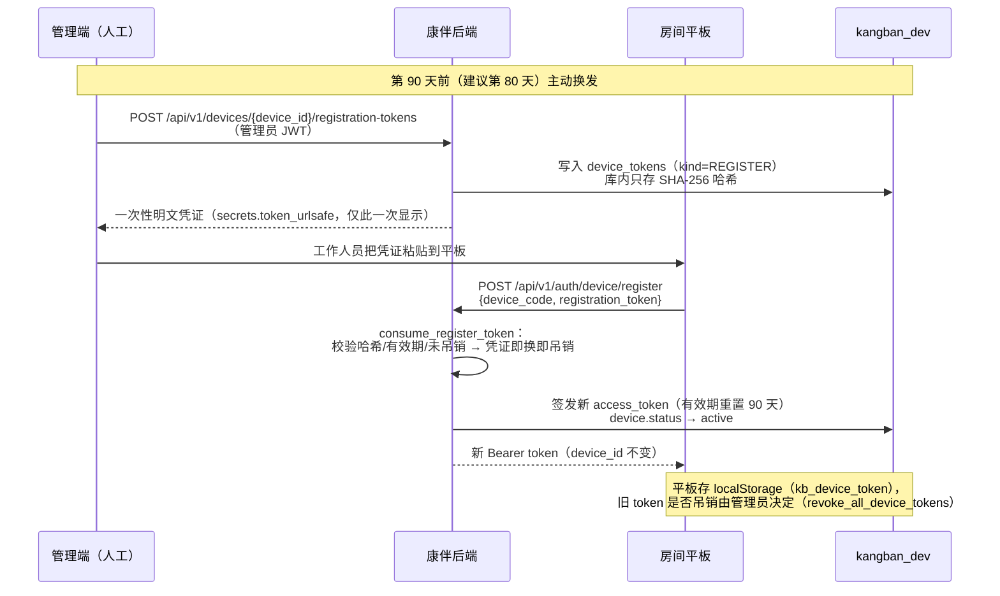

# 设备 Token 续期与记忆继承分析

> 记录日期：2026-11-13（对话历史可视化 段 5 交付物）
> 结论先行：**设备 token 90 天续期不丢任何数据**——会话、记忆全部按 `elder_id` 归属，token 只决定"谁能进门"，不决定"数据挂谁名下"。真正的风险点是**换设备**与**声纹门禁 token 的短时效**，均有明确处置路径（见下）。

## 一、续期链路

设备 token 是平板（专机专用）的长期凭证，有效期 `device_token_expire_days = 90` 天（`app/core/config.py`）。续期 = 管理员签发一次性注册凭证 → 平板换发新 access token，**device_id 全程不变**。

关键代码位置：

| 环节 | 位置 |
| --- | --- |
| 90 天有效期 | `app/core/config.py` `device_token_expire_days: int = 90` |
| 签发一次性注册凭证 | `app/auth/device_token.py` `issue_register_token`（明文只返回一次，库内 SHA-256） |
| 凭证换发 access token | `app/auth/device_token.py` `consume_register_token` + `app/services/device.py` `register_device`（一次性即换即吊销，设备置 active） |
| 前端持久化 | `elder.html` / `voice.js`：localStorage `kb_device_token`，浏览器重启自动恢复会话 |

## 二、各层数据的"归属键"与继承结论

| 数据层 | 归属键 | 续期（同设备换发） | 换设备（新 device_id） |
| --- | --- | --- | --- |
| 会话列表 / 消息（conversations） | **elder_id**（段 1 起按 elder_id 聚合；device_id 只是产生会话的设备归因） | 完整继承 | **完整继承**（新设备声纹确认后照常可见） |
| 长期记忆（memory_chunks） | **elder_id** | 完整继承 | 完整继承 |
| 落库游标（conversations.memory_upto_seq） | thread_id | 继承 | 继承 |
| 声纹（voiceprints） | elder_id + device_id | 继承（同设备同声纹） | 需在新设备重新录入或管理员通道录入（双人间必须管理员指定，ADR-005） |
| WS 会话态（Redis SessionState） | thread_id | 进程内短态，自然过期，不涉继承 | 同左 |
| 声纹门禁 token（voice_token_store） | device_id + elder_id，进程内 300s | 过期后重说一句话即可 | 同左 |

**结论**：
1. **token 过期本身无害**：过期后设备请求 401 → 前端引导回验证入口页重新走注册换发，不触碰任何业务数据。
2. **续期不丢数据**：access token 换发只改凭证本身，device_id、elder_id、绑定关系全不变。
3. **会话列表按 elder_id 聚合是换设备风险的根治**（本改造段 1/段 2 决策）：即使换了新平板（新 device_id），长者声纹确认后历史列表与记忆照常可见、可「继续对话」。
4. 匿名线程（elder_id=NULL）在任何设备上都永不展示——声纹确认门禁保证"只看到自己的历史"。

## 三、换设备场景处置

**场景**：平板损坏/升级，房间换新设备（新 device_code、新 device_id）。

1. 管理端创建新设备 → 为其签发一次性注册凭证 → 新平板 `POST /api/v1/auth/device/register` 激活。
2. 管理端在新设备上完成长者绑定（单人间自动锁定 / 双人间人工绑定）。
3. 长者对新设备录声纹（或管理员通道录入）；说第一句话通过声纹门禁（300s token）。
4. 打开「历史对话」→ 按 elder_id 聚合的列表完整呈现旧设备上的所有会话（旧会话记录的 device_id 仍指向旧设备，仅作归因，不影响可见性与续聊）。
5. 点「继续对话」→ activate 后下一轮语音/文字自动落入该会话（WS 每轮重选最近 ACTIVE 会话，`app/services/voice.py` `_load_context`）。
6. 旧设备：吊销其全部 token（`revoke_all_device_tokens`），防止遗失设备残留有效凭证。

## 四、运维清单（90 天续期 SOP）

| 时点 | 动作 | 责任人 | 校验 |
| --- | --- | --- | --- |
| 第 80 天（到期前 10 天） | 排查全部 `device_tokens`（kind=ACCESS）的 `expires_at`，列出 10 天内到期设备 | 管理员 | — |
| 第 80~85 天 | 对到期设备调用 `POST /api/v1/devices/{id}/registration-tokens`，把一次性凭证送达对应房间平板 | 管理员 + 护工 | 凭证明文仅显示一次，当场送达 |
| 平板侧 | 打开入口页粘贴凭证换发（或由工作人员操作） | 护工 | 平板提示"设备已连接"；`GET /api/v1/devices/me` 正常 |
| 换发后 | 平板重开「历史对话」页，确认历史列表与记忆查询结果与换发前一致 | 护工 | 会话列表不变（验收清单 §六 第 5 条） |
| 任意时刻 | token 已过期（401）时：直接引导平板回 `/index.html` 重新走注册流程 | 护工 | 数据不受影响，无需人工干预 |
| 换设备时 | 新设备注册 + 绑定 + 录声纹 → 旧设备 `revoke_all_device_tokens` | 管理员 | 新设备历史可见、可继续对话 |

**红线**：
- 注册凭证是一次性明文，送达后立即失效于下一次使用；不得复用、不得入库日志。
- 全程只操作本地开发库 `kangban_dev`；凭证走 `.env` / 管理端界面，不入 git。
- 声纹原始音频不落盘、不入日志（AGENTS.md 实时规则第 4 条）。

## 五、遗留风险与边界

| 风险 | 现状 | 处置 |
| --- | --- | --- |
| 声纹门禁 token 300s 进程内失效 | 服务重启或超时后历史区回到遮罩态，需重说一句话 | 前端 403 identity_locked 自动回遮罩（已实现），属可见降级，非故障 |
| 服务重启丢 Redis 会话态 | SessionState / 游标缓存丢失 | 游标以 DB 列为准（迁移 0010）；会话从 DB 恢复，无需人工处理 |
| 双人间换设备 | 声纹无法自行决定归属 | 必须走管理员通道录入（ADR-005），页面已有入口 |
| token 泄露 | 90 天长期凭证 | 管理端可随时 `revoke_all_device_tokens`；泄漏即吊销重发 |
